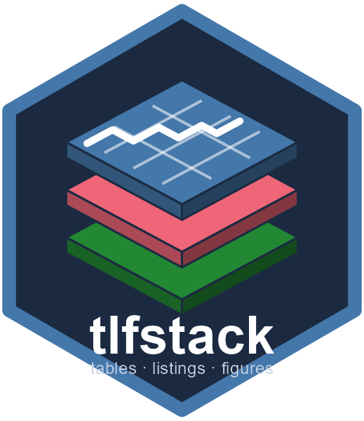

# tlfstack 

tlfstack is a *convention stack* for clinical tables, listings and figures
(TLFs) in R: the reporting conventions a SAS shop keeps in ODS templates and
a macro library, written as R code and metadata.

It rests on two design principles:

1. **One code path, two modes.** Builders are pure functions: data in, a
   table object or ggplot out. They never read data, write files or touch
   metadata. A scheduled batch program and an interactive Shiny preview make
   the same call and get the same RTF content. The two modes differ only at
   the data entry point and the output exit point.
2. **Metadata shared across languages.** Titles, footnotes and output file
   names come from one table of contents (TOC). This can be the same
   database table your SAS programs read, a snapshot of it, or a
   version-controlled JSON/YAML file. Because both sides read one source
   string, the title blocks match by construction.

## What is in the stack

| Layer | Functions |
|---|---|
| Configuration | `tlf_config()`, `tlf_page()`, `tlf_fonts()`, `tlf_render_opts()`, `tlf_get_config()` (argument > `options()` > `TLFSTACK_CONFIG` file > defaults) |
| Builders | `tbl_demographics()`, `tbl_ae()`, `tbl_ae_severity()`, `tbl_disposition()`, `tbl_eff()`, `tbl_shift()`, `tbl_tte()`, `tbl_listing()`; `fig_meanci()`, `fig_boxplot()`, `fig_spaghetti()`, `fig_lsmeans()`, `fig_km()`, `fig_forest()`, `fig_waterfall()`, `fig_edish()`, `fig_shift()` |
| Dispatcher | `tlf_build_table()`, `tlf_build_figure()`, `tlf_register_table()`, `tlf_register_figure()` |
| Titles and TOC | `tlf_titles()`, `tlf_resolve_titles()` (live, then snapshot, then fallback), `toc_source_db()`, `toc_source_file()`, `toc_source_dir()`, `toc_read()`, `toc_write()` |
| Convention engine | `theme_tlf_submission()`, `tlf_rtf_table()`, `tlf_rtf_listing()`, `tlf_rtf_figure()` |
| pharmaverse interop | `as_tlf_table()` (gtsummary tables, cards ARD, data frames), `tlf_ard()`, `tlf_write_ard()` |
| Crash isolation | `tlf_run_isolated()`: figure rendering in a callr child process with bounded retries and an attempt log |

## Example

```r
library(tlfstack)

# Organization conventions, set once per session (for example in a site profile).
options(tlfstack.config = tlf_config(header_left = "Example Organization"))

# Titles from a TOC: a live DBI source first, then a snapshot file.
titles <- tlf_resolve_titles(
  "t_demo",
  sources = list(toc_source_dir("metadata")),   # or toc_source_db(connector, "toc")
  scope = list(study = "STUDY01")
)

# The same call a Shiny app makes.
res <- tlf_build_table("demographics", list(adsl = ex_adsl))
tlf_rtf_table(res, file.path(tempdir(), titles$output_file_name), titles = titles)
```

## Bring your own table body: gtsummary and ARD

Any gtsummary table, or Analysis Results Data from cards/cardx, renders under
the same conventions and TOC titles:

```r
library(gtsummary)
body <- tbl_summary(ex_adsl, by = TRT01A, include = c(AGE, SEX, RACE))
tlf_rtf_table(body, "t-14-01-01-demog.rtf", titles = titles)  # titles from the TOC

tlf_write_ard(body, "t-14-01-01-demog-ard.csv")  # one row per statistic, for QC against SAS
```

gtsummary footnotes are placed after the TOC footnotes. Builders registered
with `tlf_register_table()` may return gtsummary tables, so the batch/preview
dispatcher works with them too.

## Title metadata as a file

`toc_write()` dumps any TOC, including a live database table, to JSON or
YAML for offline work, code review and other languages:

```yaml
tlfstack_toc: 1
generated_at: 2026-10-22T09:00:00+0000
source: database
outputs:
  - program: t_demo
    scope: {study: STUDY01}
    type: Table
    number: "14.1.1"
    title: [Summary of Demographic and Baseline Characteristics]
    subtitle: [Safety Population]
    footnotes: [Percentages are based on the number of subjects in each column.]
    output_file_name: t-14-01-01-demog.rtf
```

The format has a published JSON Schema:
`system.file("schema", "tlfstack-toc-v1.schema.json", package = "tlfstack")`.

## Where tlfstack sits

tlfstack does not replace the table-construction or interactive-review
packages. Its scope is what sits *around* them:

- **gtsummary and cards/cardx** build table bodies and Analysis Results
  Data. tlfstack renders gtsummary tables and ARD directly (`as_tlf_table()`),
  adding the page conventions, TOC titles and RTF output around them.
- **rtables, Tplyr** build table bodies too. tlfstack renders pre-formatted
  data frames, so their output can also go through its renderers.
- **tfrmt** expresses a table's layout as metadata for review before
  database lock. tlfstack adds page and figure conventions and TOC-driven
  titles for locked output. The two are complementary.
- **teal** is interactive exploration. tlfstack's interactive mode is a
  preview of the production output.
- **chevron** generates standard TLF programs. tlfstack is a shared runtime
  layer that both batch and interactive code call.
- **r2rtf** is the RTF engine tlfstack builds on.

No single feature here is new. The contribution is the combination: one code
path for batch and interactive work, conventions as code, one metadata source
shared with SAS, and crash-tolerant figure rendering.

## Installation

tlfstack is not yet on CRAN. Install the development version from GitHub:

```r
# install.packages("pak")
pak::pak("yanmingyu92/tlfstack")
```

Documentation: <https://yanmingyu92.github.io/tlfstack/>

## Status

This is an early release. Planned work is tracked in `NEWS.md` and the issue
tracker.
